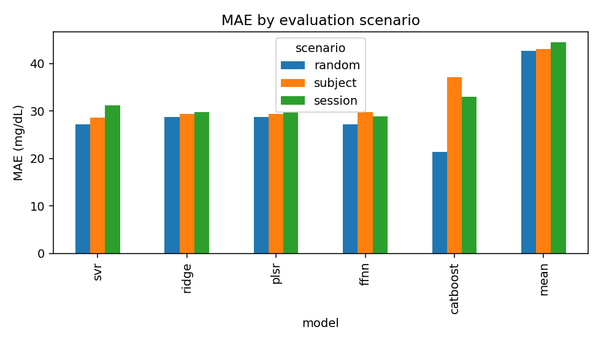

# EarSpectro experiment report

Data: `data/control_ear5.csv`

> Synthetic data: these numbers validate the pipeline, not the device. See README for what the generator does and does not model.

## Evaluation scenarios (H5)

| model    | scenario   |   MAE |   RMSE |    R2 |   MARD |   clarke_A |   subject_MAE_p90 |
|:---------|:-----------|------:|-------:|------:|-------:|-----------:|------------------:|
| catboost | random     | 21.38 |  29.27 |  0.71 |  14.91 |      72.48 |             29.05 |
| catboost | session    | 33.05 |  44.13 |  0.40 |  22.03 |      53.32 |             57.42 |
| catboost | subject    | 37.09 |  47.92 |  0.23 |  25.63 |      45.28 |             63.59 |
| ffnn     | random     | 27.13 |  37.70 |  0.53 |  18.47 |      62.64 |             38.36 |
| ffnn     | session    | 28.92 |  38.68 |  0.54 |  19.54 |      58.19 |             43.95 |
| ffnn     | subject    | 29.77 |  38.93 |  0.49 |  20.27 |      55.47 |             47.66 |
| mean     | random     | 42.74 |  54.75 | -0.00 |  30.55 |      38.06 |             81.80 |
| mean     | session    | 44.43 |  56.89 | -0.01 |  30.57 |      36.46 |             74.24 |
| mean     | subject    | 43.07 |  55.15 | -0.02 |  30.76 |      38.37 |             85.17 |
| plsr     | random     | 28.79 |  39.94 |  0.47 |  20.53 |      58.20 |             40.59 |
| plsr     | session    | 29.76 |  38.80 |  0.53 |  20.33 |      55.14 |             46.71 |
| plsr     | subject    | 29.45 |  38.34 |  0.51 |  20.98 |      56.46 |             44.31 |
| ridge    | random     | 28.76 |  39.92 |  0.47 |  20.51 |      57.98 |             40.64 |
| ridge    | session    | 29.76 |  38.80 |  0.53 |  20.33 |      55.14 |             46.71 |
| ridge    | subject    | 29.44 |  38.34 |  0.51 |  20.97 |      56.38 |             44.31 |
| svr      | random     | 27.20 |  37.13 |  0.54 |  19.03 |      60.63 |             39.20 |
| svr      | session    | 31.16 |  41.18 |  0.47 |  20.97 |      53.53 |             46.97 |
| svr      | subject    | 28.64 |  37.10 |  0.54 |  20.16 |      56.94 |             41.45 |

