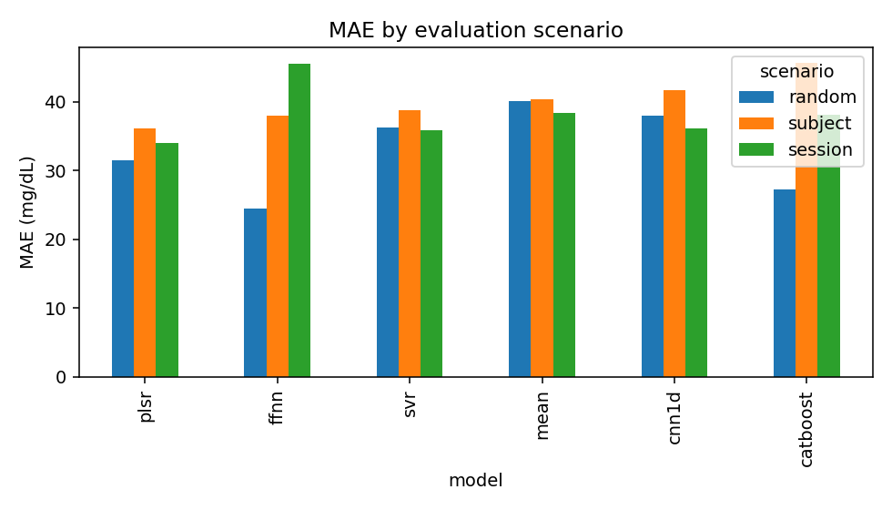
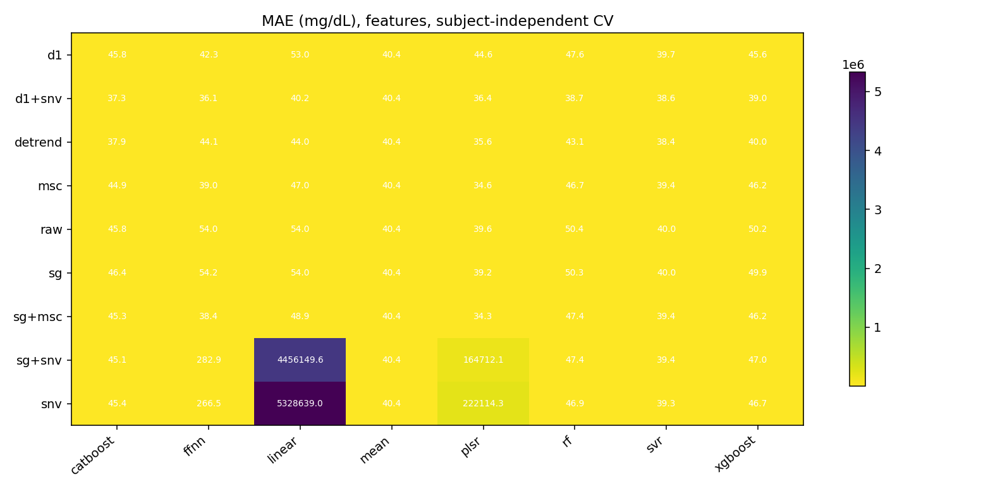
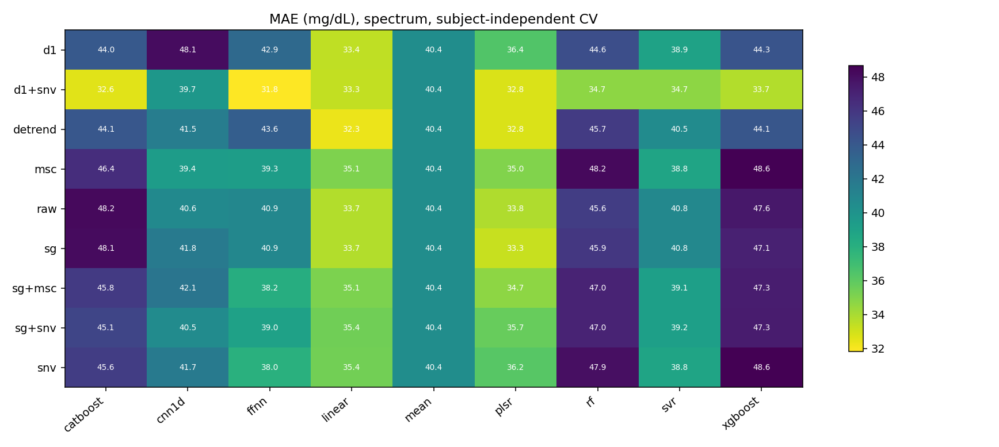
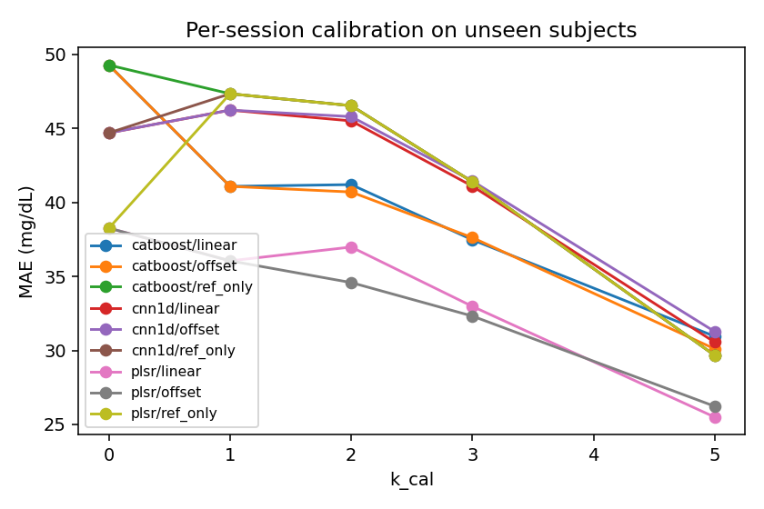
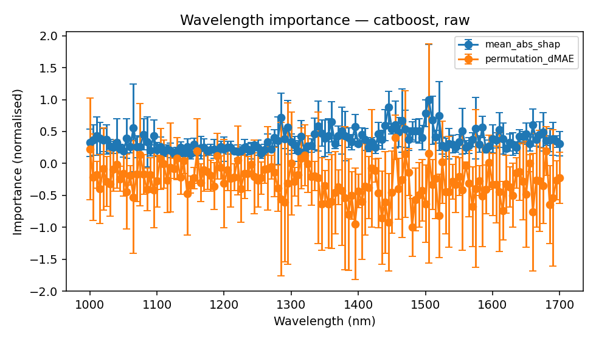
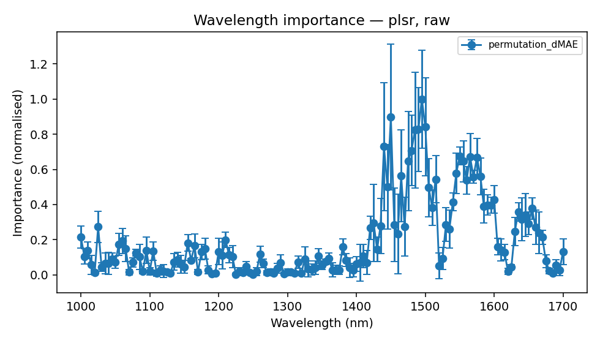

# EarSpectro experiment report

Data: `data/synthetic_dense.csv`

> Synthetic data: these numbers validate the pipeline, not the device. See README for what the generator does and does not model.

## Evaluation scenarios (H5)

| model    | scenario   |   MAE |   RMSE |    R2 |   MARD |   clarke_A |   subject_MAE_p90 |
|:---------|:-----------|------:|-------:|------:|-------:|-----------:|------------------:|
| catboost | random     | 27.25 |  37.10 |  0.51 |  18.53 |      61.82 |             48.20 |
| catboost | session    | 38.12 |  54.26 | -0.18 |  24.88 |      48.66 |             96.00 |
| catboost | subject    | 45.62 |  63.53 | -0.43 |  30.45 |      40.16 |             82.53 |
| cnn1d    | random     | 38.01 |  53.97 | -0.03 |  25.19 |      46.79 |             72.67 |
| cnn1d    | session    | 36.15 |  49.38 |  0.02 |  24.49 |      46.68 |             63.40 |
| cnn1d    | subject    | 41.73 |  60.08 | -0.28 |  27.50 |      44.00 |             74.11 |
| ffnn     | random     | 24.48 |  33.77 |  0.60 |  16.93 |      67.88 |             34.52 |
| ffnn     | session    | 45.49 |  63.75 | -0.63 |  30.92 |      45.12 |            103.12 |
| ffnn     | subject    | 37.96 |  55.44 | -0.09 |  24.82 |      49.58 |             73.61 |
| mean     | random     | 40.14 |  53.26 | -0.00 |  28.29 |      40.07 |             69.37 |
| mean     | session    | 38.44 |  50.00 | -0.00 |  27.37 |      41.59 |             62.03 |
| mean     | subject    | 40.43 |  53.54 | -0.02 |  28.85 |      40.56 |             63.50 |
| plsr     | random     | 31.56 |  40.39 |  0.42 |  22.62 |      51.97 |             52.19 |
| plsr     | session    | 34.03 |  43.40 |  0.25 |  24.60 |      49.62 |             56.73 |
| plsr     | subject    | 36.18 |  46.69 |  0.23 |  25.82 |      46.52 |             55.86 |
| svr      | random     | 36.34 |  53.17 |  0.00 |  22.89 |      50.29 |             74.34 |
| svr      | session    | 35.92 |  51.53 | -0.06 |  23.09 |      48.77 |             77.26 |
| svr      | subject    | 38.81 |  56.10 | -0.11 |  24.90 |      46.66 |             77.90 |

## Model x preprocessing matrix — `matrix_subject` (H1, H3, H4)

Top 15 by MAE:

| representation   | preprocessing   | model    |   MAE |   RMSE |   R2 |   clarke_A |
|:-----------------|:----------------|:---------|------:|-------:|-----:|-----------:|
| spectrum         | d1+snv          | ffnn     | 31.81 |  43.16 | 0.34 |      53.91 |
| spectrum         | detrend         | linear   | 32.29 |  41.74 | 0.38 |      51.65 |
| spectrum         | d1+snv          | catboost | 32.58 |  45.45 | 0.27 |      54.53 |
| spectrum         | d1+snv          | plsr     | 32.75 |  42.15 | 0.37 |      51.63 |
| spectrum         | detrend         | plsr     | 32.78 |  42.44 | 0.36 |      51.01 |
| spectrum         | sg              | plsr     | 33.25 |  43.17 | 0.34 |      50.12 |
| spectrum         | d1+snv          | linear   | 33.33 |  42.47 | 0.36 |      49.26 |
| spectrum         | d1              | linear   | 33.41 |  43.24 | 0.34 |      50.26 |
| spectrum         | d1+snv          | xgboost  | 33.73 |  45.55 | 0.27 |      51.25 |
| spectrum         | sg              | linear   | 33.73 |  43.65 | 0.33 |      50.20 |
| spectrum         | raw             | linear   | 33.74 |  43.66 | 0.33 |      49.85 |
| spectrum         | raw             | plsr     | 33.82 |  43.75 | 0.32 |      49.50 |
| features         | sg+msc          | plsr     | 34.27 |  44.79 | 0.29 |      49.40 |
| features         | msc             | plsr     | 34.65 |  45.45 | 0.27 |      48.70 |
| spectrum         | sg+msc          | plsr     | 34.65 |  44.78 | 0.29 |      48.32 |

## Feature selection on engineered features

| model    | selector   |   k_features |   MAE |    R2 |
|:---------|:-----------|-------------:|------:|------:|
| svr      | none       |           20 | 39.98 | -0.12 |
| svr      | corr       |            5 | 40.09 | -0.18 |
| svr      | corr       |           10 | 40.04 | -0.18 |
| svr      | corr       |           20 | 40.34 | -0.20 |
| svr      | mrmr       |            5 | 39.35 | -0.13 |
| svr      | mrmr       |           10 | 39.72 | -0.15 |
| svr      | mrmr       |           20 | 40.96 | -0.18 |
| svr      | rfe        |            5 | 39.27 | -0.08 |
| svr      | rfe        |           10 | 39.61 | -0.10 |
| svr      | rfe        |           20 | 40.34 | -0.16 |
| catboost | none       |           20 | 45.75 | -0.38 |
| catboost | corr       |            5 | 45.19 | -0.39 |
| catboost | corr       |           10 | 46.10 | -0.40 |
| catboost | corr       |           20 | 49.38 | -0.57 |
| catboost | mrmr       |            5 | 48.29 | -0.43 |
| catboost | mrmr       |           10 | 48.10 | -0.45 |
| catboost | mrmr       |           20 | 46.81 | -0.40 |
| catboost | rfe        |            5 | 50.02 | -0.60 |
| catboost | rfe        |           10 | 49.23 | -0.57 |
| catboost | rfe        |           20 | 47.87 | -0.49 |

## Calibration burden (H6)

`ref_only` ignores the spectra (predicts the mean calibration reference); a model is only adding information where it beats `ref_only` at the same k.

| model    | method   |   k_cal |   MAE |   delta_MAE |    R2 |    n |
|:---------|:---------|--------:|------:|------------:|------:|-----:|
| plsr     | offset   |       0 | 38.26 |        0.00 |  0.24 | 2554 |
| plsr     | offset   |       1 | 36.05 |       -2.21 |  0.34 | 2554 |
| plsr     | offset   |       2 | 34.58 |       -3.68 |  0.39 | 2554 |
| plsr     | offset   |       3 | 32.32 |       -5.94 |  0.45 | 2554 |
| plsr     | offset   |       5 | 26.23 |      -12.03 |  0.64 | 2554 |
| plsr     | linear   |       0 | 38.26 |        0.00 |  0.24 | 2554 |
| plsr     | linear   |       1 | 36.05 |       -2.21 |  0.34 | 2554 |
| plsr     | linear   |       2 | 36.98 |       -1.28 |  0.31 | 2554 |
| plsr     | linear   |       3 | 32.98 |       -5.29 |  0.43 | 2554 |
| plsr     | linear   |       5 | 25.50 |      -12.76 |  0.64 | 2554 |
| plsr     | ref_only |       0 | 38.26 |        0.00 |  0.24 | 2554 |
| plsr     | ref_only |       1 | 47.34 |        9.08 | -0.09 | 2554 |
| plsr     | ref_only |       2 | 46.53 |        8.27 | -0.07 | 2554 |
| plsr     | ref_only |       3 | 41.39 |        3.13 |  0.10 | 2554 |
| plsr     | ref_only |       5 | 29.67 |       -8.59 |  0.49 | 2554 |
| catboost | offset   |       0 | 49.27 |        0.00 | -0.48 | 2554 |
| catboost | offset   |       1 | 41.08 |       -8.19 |  0.08 | 2554 |
| catboost | offset   |       2 | 40.70 |       -8.57 |  0.10 | 2554 |
| catboost | offset   |       3 | 37.62 |      -11.65 |  0.22 | 2554 |
| catboost | offset   |       5 | 30.11 |      -19.17 |  0.52 | 2554 |
| catboost | linear   |       0 | 49.27 |        0.00 | -0.48 | 2554 |
| catboost | linear   |       1 | 41.08 |       -8.19 |  0.08 | 2554 |
| catboost | linear   |       2 | 41.20 |       -8.07 |  0.08 | 2554 |
| catboost | linear   |       3 | 37.47 |      -11.80 |  0.22 | 2554 |
| catboost | linear   |       5 | 30.95 |      -18.32 |  0.50 | 2554 |
| catboost | ref_only |       0 | 49.27 |        0.00 | -0.48 | 2554 |
| catboost | ref_only |       1 | 47.34 |       -1.94 | -0.09 | 2554 |
| catboost | ref_only |       2 | 46.53 |       -2.74 | -0.07 | 2554 |
| catboost | ref_only |       3 | 41.39 |       -7.88 |  0.10 | 2554 |
| catboost | ref_only |       5 | 29.67 |      -19.61 |  0.49 | 2554 |
| cnn1d    | offset   |       0 | 44.69 |        0.00 | -0.32 | 2554 |
| cnn1d    | offset   |       1 | 46.23 |        1.54 | -0.06 | 2554 |
| cnn1d    | offset   |       2 | 45.79 |        1.10 | -0.05 | 2554 |
| cnn1d    | offset   |       3 | 41.45 |       -3.25 |  0.10 | 2554 |
| cnn1d    | offset   |       5 | 31.27 |      -13.42 |  0.47 | 2554 |
| cnn1d    | linear   |       0 | 44.69 |        0.00 | -0.32 | 2554 |
| cnn1d    | linear   |       1 | 46.23 |        1.54 | -0.06 | 2554 |
| cnn1d    | linear   |       2 | 45.51 |        0.81 | -0.04 | 2554 |
| cnn1d    | linear   |       3 | 41.10 |       -3.60 |  0.11 | 2554 |
| cnn1d    | linear   |       5 | 30.56 |      -14.14 |  0.48 | 2554 |
| cnn1d    | ref_only |       0 | 44.69 |        0.00 | -0.32 | 2554 |
| cnn1d    | ref_only |       1 | 47.34 |        2.64 | -0.09 | 2554 |
| cnn1d    | ref_only |       2 | 46.53 |        1.84 | -0.07 | 2554 |
| cnn1d    | ref_only |       3 | 41.39 |       -3.31 |  0.10 | 2554 |
| cnn1d    | ref_only |       5 | 29.67 |      -15.03 |  0.49 | 2554 |

## Wavelength importance on held-out subjects

| model    | method           |   wavelength |       mean |      std |   mean_rank |   rank_std |
|:---------|:-----------------|-------------:|-----------:|---------:|------------:|-----------:|
| plsr     | permutation_dMAE |     1.5e+03  | 381        | 107      |         2   |       1.22 |
| plsr     | permutation_dMAE |     1.45e+03 | 342        | 158      |         6   |       7.52 |
| plsr     | permutation_dMAE |     1.49e+03 | 315        |  90.9    |         6.6 |       2.7  |
| plsr     | permutation_dMAE |     1.5e+03  | 321        | 106      |         6.6 |       4.34 |
| plsr     | permutation_dMAE |     1.48e+03 | 313        | 126      |         7   |       5.1  |
| plsr     | permutation_dMAE |     1.55e+03 | 258        |  19.7    |         8.2 |       5.45 |
| plsr     | permutation_dMAE |     1.58e+03 | 255        |  40.7    |         8.2 |       3.63 |
| plsr     | permutation_dMAE |     1.48e+03 | 269        |  76.6    |         8.6 |       4.16 |
| plsr     | permutation_dMAE |     1.56e+03 | 246        |  44.5    |         9   |       3.61 |
| plsr     | permutation_dMAE |     1.56e+03 | 256        |  49.9    |         9.2 |       1.92 |
| plsr     | permutation_dMAE |     1.44e+03 | 278        | 138      |        11.6 |       8.11 |
| plsr     | permutation_dMAE |     1.48e+03 | 247        | 107      |        12.4 |       5.68 |
| plsr     | permutation_dMAE |     1.54e+03 | 220        |  44      |        13.4 |       6.69 |
| plsr     | permutation_dMAE |     1.58e+03 | 214        |  39.9    |        13.4 |       3.78 |
| plsr     | permutation_dMAE |     1.57e+03 | 212        |  13.7    |        14.2 |       6.83 |
| plsr     | permutation_dMAE |     1.52e+03 | 207        |  51.3    |        14.8 |       2.86 |
| plsr     | permutation_dMAE |     1.56e+03 | 205        |  29.5    |        15.2 |       4.76 |
| plsr     | permutation_dMAE |     1.46e+03 | 214        |  99.7    |        17   |      10.8  |
| plsr     | permutation_dMAE |     1.5e+03  | 189        |  62.8    |        19.2 |       3.7  |
| plsr     | permutation_dMAE |     1.44e+03 | 191        |  91.5    |        20.4 |      10.2  |
| plsr     | permutation_dMAE |     1.6e+03  | 163        |  30.2    |        23.4 |       8.47 |
| plsr     | permutation_dMAE |     1.6e+03  | 151        |  17.3    |        24   |       7.52 |
| plsr     | permutation_dMAE |     1.54e+03 | 158        |  19.1    |        24.6 |       5.73 |
| plsr     | permutation_dMAE |     1.59e+03 | 152        |  21.3    |        25.2 |       2.28 |
| plsr     | permutation_dMAE |     1.58e+03 | 149        |  36.8    |        25.8 |       1.92 |
| plsr     | permutation_dMAE |     1.66e+03 | 144        |  23.8    |        26.4 |       3.21 |
| plsr     | permutation_dMAE |     1.51e+03 | 146        |  38.8    |        27.4 |       7.27 |
| plsr     | permutation_dMAE |     1.64e+03 | 136        |  20.2    |        29   |       6.93 |
| plsr     | permutation_dMAE |     1.64e+03 | 130        |  46.5    |        31.4 |       8.29 |
| plsr     | permutation_dMAE |     1.64e+03 | 121        |  46.5    |        33.6 |       7.09 |
| plsr     | permutation_dMAE |     1.65e+03 | 111        |  24.6    |        35.2 |       3.35 |
| plsr     | permutation_dMAE |     1.02e+03 | 104        |  34      |        36.2 |      14    |
| plsr     | permutation_dMAE |     1.44e+03 | 106        |  60.2    |        37.2 |      13.6  |
| plsr     | permutation_dMAE |     1.53e+03 | 109        |  36.9    |        37.6 |       4.45 |
| plsr     | permutation_dMAE |     1.66e+03 | 103        |  37.2    |        38.2 |       5.89 |
| plsr     | permutation_dMAE |     1.42e+03 | 102        |  25.1    |        38.8 |       3.49 |
| plsr     | permutation_dMAE |     1.63e+03 |  93.7      |  30.7    |        42.2 |       8.01 |
| plsr     | permutation_dMAE |     1.67e+03 |  81.4      |  15.2    |        42.2 |       2.05 |
| plsr     | permutation_dMAE |     1.54e+03 |  99.1      |  41.4    |        43   |      15.3  |
| plsr     | permutation_dMAE |     1e+03    |  81.9      |  24.4    |        43.2 |       7.69 |
| plsr     | permutation_dMAE |     1.47e+03 | 104        |  63.4    |        44.6 |      26.9  |
| plsr     | permutation_dMAE |     1.21e+03 |  75.7      |  16.7    |        45.2 |      11.3  |
| plsr     | permutation_dMAE |     1.66e+03 |  91        |  45.3    |        46.2 |      11.8  |
| plsr     | permutation_dMAE |     1.42e+03 | 112        |  83.3    |        48.2 |      29.7  |
| plsr     | permutation_dMAE |     1.06e+03 |  73.6      |  27.4    |        48.4 |      10.7  |
| plsr     | permutation_dMAE |     1.16e+03 |  69.1      |  17.5    |        48.8 |      12.4  |
| plsr     | permutation_dMAE |     1.46e+03 | 108        |  79.9    |        49.2 |      36.9  |
| plsr     | permutation_dMAE |     1.06e+03 |  65.9      |  23.4    |        51.6 |      16.2  |
| plsr     | permutation_dMAE |     1.46e+03 |  88.8      |  86.5    |        52.6 |      30.1  |
| plsr     | permutation_dMAE |     1.38e+03 |  60.3      |  17.5    |        54.4 |       8.79 |
| plsr     | permutation_dMAE |     1.6e+03  |  60.9      |  18      |        54.4 |       7.44 |
| plsr     | permutation_dMAE |     1.16e+03 |  62.9      |  25.7    |        55.4 |      14.2  |
| plsr     | permutation_dMAE |     1.06e+03 |  56.2      |  28      |        60   |      14.6  |
| plsr     | permutation_dMAE |     1.18e+03 |  57        |  22.6    |        60   |      15.3  |
| plsr     | permutation_dMAE |     1.01e+03 |  53.2      |  17.5    |        60.2 |      10.3  |
| plsr     | permutation_dMAE |     1.1e+03  |  51.7      |  19.5    |        60.2 |      16.8  |
| plsr     | permutation_dMAE |     1.43e+03 |  55.1      |  26.6    |        60.6 |      20.4  |
| plsr     | permutation_dMAE |     1.61e+03 |  54        |  24.3    |        62.2 |      19.9  |
| plsr     | permutation_dMAE |     1.08e+03 |  47.7      |   7.28   |        62.4 |      10.1  |
| plsr     | permutation_dMAE |     1.1e+03  |  53.3      |  28.9    |        63.6 |      16.7  |
| plsr     | permutation_dMAE |     1.18e+03 |  49.6      |  16.4    |        63.8 |      12.2  |
| plsr     | permutation_dMAE |     1.62e+03 |  48.9      |  16.5    |        63.8 |      15.5  |
| plsr     | permutation_dMAE |     1.7e+03  |  50.5      |  27.9    |        64.8 |      25.2  |
| plsr     | permutation_dMAE |     1.2e+03  |  50.6      |  28.5    |        66.4 |      18.5  |
| plsr     | permutation_dMAE |     1.26e+03 |  45.1      |  17.6    |        67.2 |       9.26 |
| plsr     | permutation_dMAE |     1.22e+03 |  43.2      |  16.8    |        67.6 |      11.3  |
| plsr     | permutation_dMAE |     1.34e+03 |  40.4      |  16      |        71   |      14.3  |
| plsr     | permutation_dMAE |     1e+03    |  40.1      |  17.1    |        72.6 |      11.2  |
| plsr     | permutation_dMAE |     1.41e+03 |  40.8      |  25.7    |        73.2 |      32.3  |
| plsr     | permutation_dMAE |     1.22e+03 |  39.5      |  24      |        74.6 |      20    |
| plsr     | permutation_dMAE |     1.36e+03 |  35.5      |  11.9    |        75.4 |       9.89 |
| plsr     | permutation_dMAE |     1.16e+03 |  32        |   2.96   |        76.2 |       7.4  |
| plsr     | permutation_dMAE |     1.04e+03 |  34.6      |  12.7    |        76.8 |      14    |
| plsr     | permutation_dMAE |     1.2e+03  |  41.6      |  29.3    |        76.8 |      29.2  |
| plsr     | permutation_dMAE |     1.08e+03 |  39        |  27.5    |        78.4 |      29.4  |
| plsr     | permutation_dMAE |     1.14e+03 |  32.9      |  15.7    |        79   |      19.1  |
| plsr     | permutation_dMAE |     1.32e+03 |  34.3      |  26.8    |        79   |      16.3  |
| plsr     | permutation_dMAE |     1.38e+03 |  32.1      |  14.2    |        79.2 |      15.1  |
| plsr     | permutation_dMAE |     1.52e+03 |  35.5      |  24      |        79.2 |      27.6  |
| plsr     | permutation_dMAE |     1.36e+03 |  28.3      |   5.65   |        80.8 |       6.72 |
| plsr     | permutation_dMAE |     1.68e+03 |  29.7      |  13.6    |        81   |      19    |
| plsr     | permutation_dMAE |     1.08e+03 |  27.4      |  10      |        83   |      11.9  |
| plsr     | permutation_dMAE |     1.14e+03 |  27.7      |  17.8    |        83   |      18.6  |
| plsr     | permutation_dMAE |     1.32e+03 |  27.5      |  13.8    |        83.2 |      18    |
| plsr     | permutation_dMAE |     1.05e+03 |  27.6      |  13      |        84.6 |      20.7  |
| plsr     | permutation_dMAE |     1.26e+03 |  24.8      |   9.62   |        85.8 |      10    |
| plsr     | permutation_dMAE |     1.29e+03 |  26.7      |  16.3    |        85.8 |      22.4  |
| plsr     | permutation_dMAE |     1.04e+03 |  24.8      |  23.5    |        88.8 |      28.2  |
| plsr     | permutation_dMAE |     1.42e+03 |  26.7      |  26      |        88.8 |      32.9  |
| plsr     | permutation_dMAE |     1.4e+03  |  23.3      |  16.1    |        89   |      17.2  |
| plsr     | permutation_dMAE |     1.35e+03 |  20.9      |   8.92   |        89.8 |       7.09 |
| plsr     | permutation_dMAE |     1.69e+03 |  21        |  11.4    |        91.2 |      11.2  |
| plsr     | permutation_dMAE |     1.14e+03 |  23        |  19.4    |        91.6 |      22.2  |
| plsr     | permutation_dMAE |     1.04e+03 |  24.9      |  22.3    |        92.4 |      33.1  |
| plsr     | permutation_dMAE |     1.62e+03 |  17.1      |   4.9    |        95   |       4.9  |
| plsr     | permutation_dMAE |     1.02e+03 |  21.9      |  20.6    |        95.4 |      21.3  |
| plsr     | permutation_dMAE |     1.03e+03 |  17.2      |   9.03   |        96.6 |      16.9  |
| plsr     | permutation_dMAE |     1.24e+03 |  17.8      |  10.8    |        98.8 |      19.4  |
| plsr     | permutation_dMAE |     1.4e+03  |  26.1      |  39.8    |        99.6 |      36.6  |
| plsr     | permutation_dMAE |     1.15e+03 |  17.5      |  14.1    |       100   |      27.5  |
| plsr     | permutation_dMAE |     1.34e+03 |  15.5      |  14.9    |       101   |      17.9  |
| plsr     | permutation_dMAE |     1.28e+03 |  14.2      |  10.6    |       102   |      15.4  |
| plsr     | permutation_dMAE |     1.39e+03 |  15.6      |  20.8    |       103   |      32.3  |
| plsr     | permutation_dMAE |     1.52e+03 |  19.5      |  27.5    |       105   |      38.5  |
| plsr     | permutation_dMAE |     1.36e+03 |  10.9      |  14.9    |       108   |      23.1  |
| plsr     | permutation_dMAE |     1.34e+03 |  11.3      |  12.1    |       109   |      19    |
| plsr     | permutation_dMAE |     1.18e+03 |  10.8      |   8.87   |       109   |      17.3  |
| plsr     | permutation_dMAE |     1.37e+03 |  10.8      |   9.67   |       110   |      19.2  |
| plsr     | permutation_dMAE |     1.38e+03 |  10        |   9.67   |       110   |      16.8  |
| plsr     | permutation_dMAE |     1.09e+03 |   7.44     |   4.88   |       110   |      15.5  |
| plsr     | permutation_dMAE |     1.33e+03 |  13.1      |  17.4    |       111   |      28.5  |
| plsr     | permutation_dMAE |     1.12e+03 |   9.62     |  10.6    |       111   |      22.5  |
| plsr     | permutation_dMAE |     1.12e+03 |   6.58     |   3.32   |       112   |      11.9  |
| plsr     | permutation_dMAE |     1.4e+03  |  10        |  14.4    |       112   |      26.2  |
| plsr     | permutation_dMAE |     1.68e+03 |   8.67     |   5.95   |       112   |      16.1  |
| plsr     | permutation_dMAE |     1.7e+03  |  10.6      |  11.7    |       114   |      27.3  |
| plsr     | permutation_dMAE |     1.1e+03  |   8.05     |   7.98   |       114   |      21.1  |
| plsr     | permutation_dMAE |     1.28e+03 |   6.44     |   6.05   |       115   |      17.9  |
| plsr     | permutation_dMAE |     1.3e+03  |   5.88     |   4.88   |       115   |      12.9  |
| plsr     | permutation_dMAE |     1.3e+03  |   6.35     |   5.93   |       116   |      13.3  |
| plsr     | permutation_dMAE |     1.62e+03 |   7.35     |   6.77   |       116   |      17.4  |
| plsr     | permutation_dMAE |     1.26e+03 |   7.35     |   8.81   |       117   |      14    |
| plsr     | permutation_dMAE |     1.23e+03 |   7.11     |   8.36   |       117   |      18.7  |
| plsr     | permutation_dMAE |     1.17e+03 |   6.06     |   5.18   |       118   |      15.6  |
| plsr     | permutation_dMAE |     1.07e+03 |   5.76     |   6.3    |       118   |      18.4  |
| plsr     | permutation_dMAE |     1.24e+03 |   4.3      |   2.94   |       118   |      11.1  |
| plsr     | permutation_dMAE |     1.24e+03 |   5.3      |   3.93   |       119   |      10.3  |
| plsr     | permutation_dMAE |     1.12e+03 |   7.91     |  14      |       120   |      23.8  |
| plsr     | permutation_dMAE |     1.02e+03 |   5.12     |   5.26   |       121   |      10.9  |
| plsr     | permutation_dMAE |     1.13e+03 |   3.97     |   5.41   |       121   |      15.1  |
| plsr     | permutation_dMAE |     1.2e+03  |   3.25     |   2.95   |       122   |      11    |
| plsr     | permutation_dMAE |     1.31e+03 |   3.65     |   3.74   |       122   |      13.2  |
| plsr     | permutation_dMAE |     1.68e+03 |   3.06     |   2.57   |       123   |       9.91 |
| plsr     | permutation_dMAE |     1.27e+03 |   4.45     |   4.75   |       123   |      11.6  |
| plsr     | permutation_dMAE |     1.28e+03 |   3.11     |   3.07   |       124   |      11.5  |
| plsr     | permutation_dMAE |     1.32e+03 |   2.97     |   3.19   |       124   |      10.7  |
| plsr     | permutation_dMAE |     1.11e+03 |   3.82     |   6.23   |       125   |      10    |
| plsr     | permutation_dMAE |     1.19e+03 |   2.3      |   1.93   |       125   |       8.14 |
| plsr     | permutation_dMAE |     1.3e+03  |   2.26     |   3.08   |       128   |       9.63 |
| plsr     | permutation_dMAE |     1.22e+03 |   1.27     |   1.95   |       131   |       9.28 |
| plsr     | permutation_dMAE |     1.25e+03 |   0.345    |   0.644  |       133   |       4.28 |
| catboost | mean_abs_shap    |     1.44e+03 |   1.19     |   0.344  |         6.8 |       3.35 |
| catboost | mean_abs_shap    |     1.5e+03  |   1.07     |   0.289  |        10.2 |       7.12 |
| catboost | mean_abs_shap    |     1.5e+03  |   1.36     |   1.17   |        14.6 |      13.2  |
| catboost | mean_abs_shap    |     1.28e+03 |   0.977    |   0.519  |        20.8 |      20.5  |
| catboost | mean_abs_shap    |     1.36e+03 |   0.885    |   0.433  |        22   |      17.2  |
| catboost | mean_abs_shap    |     1.4e+03  |   0.778    |   0.258  |        23.8 |      10.3  |
| catboost | mean_abs_shap    |     1.45e+03 |   0.736    |   0.103  |        24.4 |      11.5  |
| catboost | mean_abs_shap    |     1.52e+03 |   1.01     |   0.73   |        24.4 |      13.2  |
| catboost | mean_abs_shap    |     1.66e+03 |   0.815    |   0.349  |        28   |      28.4  |
| catboost | mean_abs_shap    |     1.51e+03 |   0.921    |   0.509  |        28.2 |      26    |
| catboost | mean_abs_shap    |     1.58e+03 |   0.776    |   0.228  |        29.2 |      24.5  |
| catboost | mean_abs_shap    |     1.44e+03 |   0.814    |   0.335  |        30.8 |      29    |
| catboost | mean_abs_shap    |     1.48e+03 |   0.689    |   0.197  |        32   |      22.6  |
| catboost | mean_abs_shap    |     1.49e+03 |   0.693    |   0.259  |        35.2 |      26.4  |
| catboost | mean_abs_shap    |     1.65e+03 |   0.633    |   0.229  |        36.2 |      17.3  |
| catboost | mean_abs_shap    |     1.48e+03 |   0.698    |   0.238  |        36.6 |      24.4  |
| catboost | mean_abs_shap    |     1.46e+03 |   0.825    |   0.498  |        37.6 |      36.2  |
| catboost | mean_abs_shap    |     1.4e+03  |   0.618    |   0.135  |        39.8 |      24.4  |
| catboost | mean_abs_shap    |     1.3e+03  |   0.775    |   0.571  |        41.8 |      43.8  |
| catboost | mean_abs_shap    |     1.34e+03 |   0.796    |   0.531  |        42   |      46.6  |
| catboost | mean_abs_shap    |     1.64e+03 |   0.569    |   0.115  |        42.2 |      17    |
| catboost | mean_abs_shap    |     1.46e+03 |   0.669    |   0.314  |        42.4 |      25.1  |
| catboost | mean_abs_shap    |     1.47e+03 |   0.734    |   0.394  |        42.4 |      40.4  |
| catboost | mean_abs_shap    |     1.34e+03 |   0.645    |   0.282  |        42.6 |      32.8  |
| catboost | mean_abs_shap    |     1.46e+03 |   0.914    |   0.67   |        42.6 |      41    |
| catboost | mean_abs_shap    |     1.61e+03 |   0.716    |   0.37   |        43.2 |      53    |
| catboost | mean_abs_shap    |     1.64e+03 |   0.575    |   0.149  |        43.8 |      13.5  |
| catboost | mean_abs_shap    |     1.28e+03 |   0.548    |   0.176  |        44.4 |      28.5  |
| catboost | mean_abs_shap    |     1.52e+03 |   0.569    |   0.137  |        44.8 |      18.8  |
| catboost | mean_abs_shap    |     1.34e+03 |   0.63     |   0.335  |        45.8 |      29.6  |
| catboost | mean_abs_shap    |     1.43e+03 |   0.628    |   0.244  |        46.6 |      43.2  |
| catboost | mean_abs_shap    |     1.08e+03 |   0.62     |   0.328  |        47.4 |      48.8  |
| catboost | mean_abs_shap    |     1.67e+03 |   0.612    |   0.274  |        48   |      41.7  |
| catboost | mean_abs_shap    |     1.38e+03 |   0.693    |   0.498  |        49.8 |      37.9  |
| catboost | mean_abs_shap    |     1.37e+03 |   0.589    |   0.206  |        50.6 |      39.4  |
| catboost | mean_abs_shap    |     1.1e+03  |   0.585    |   0.346  |        51.6 |      48.5  |
| catboost | mean_abs_shap    |     1.56e+03 |   0.686    |   0.483  |        52   |      49.1  |
| catboost | mean_abs_shap    |     1.58e+03 |   0.75     |   0.649  |        52   |      44.8  |
| catboost | mean_abs_shap    |     1.38e+03 |   0.551    |   0.205  |        52.6 |      31.1  |
| catboost | mean_abs_shap    |     1.66e+03 |   0.505    |   0.13   |        52.6 |      11.5  |
| catboost | mean_abs_shap    |     1.29e+03 |   0.526    |   0.214  |        53.2 |      28    |
| catboost | mean_abs_shap    |     1.32e+03 |   0.577    |   0.336  |        53.8 |      46.5  |
| catboost | mean_abs_shap    |     1.68e+03 |   0.485    |   0.101  |        54   |      24.6  |
| catboost | mean_abs_shap    |     1.5e+03  |   0.547    |   0.258  |        55.4 |      32.4  |
| catboost | mean_abs_shap    |     1.68e+03 |   0.673    |   0.409  |        55.4 |      55.9  |
| catboost | mean_abs_shap    |     1.36e+03 |   0.588    |   0.359  |        60.2 |      47.6  |
| catboost | mean_abs_shap    |     1.01e+03 |   0.585    |   0.404  |        61.2 |      56.9  |
| catboost | mean_abs_shap    |     1.48e+03 |   0.514    |   0.238  |        61.2 |      34.9  |
| catboost | mean_abs_shap    |     1.57e+03 |   0.507    |   0.15   |        61.2 |      22.6  |
| catboost | mean_abs_shap    |     1.26e+03 |   0.462    |   0.165  |        61.4 |      31.5  |
| catboost | mean_abs_shap    |     1.7e+03  |   0.467    |   0.121  |        62   |      21.4  |
| catboost | mean_abs_shap    |     1.55e+03 |   0.464    |   0.147  |        62.6 |      27.9  |
| catboost | mean_abs_shap    |     1.62e+03 |   0.53     |   0.325  |        62.6 |      33.1  |
| catboost | mean_abs_shap    |     1.62e+03 |   0.448    |   0.179  |        62.6 |      44.7  |
| catboost | mean_abs_shap    |     1.41e+03 |   0.511    |   0.233  |        62.8 |      35.1  |
| catboost | mean_abs_shap    |     1.02e+03 |   0.497    |   0.251  |        63   |      40.7  |
| catboost | mean_abs_shap    |     1.44e+03 |   0.507    |   0.204  |        63.8 |      37.5  |
| catboost | mean_abs_shap    |     1.3e+03  |   0.455    |   0.178  |        64.2 |      26.7  |
| catboost | mean_abs_shap    |     1.6e+03  |   0.492    |   0.165  |        64.4 |      25.2  |
| catboost | mean_abs_shap    |     1.02e+03 |   0.533    |   0.337  |        64.6 |      47.9  |
| catboost | mean_abs_shap    |     1.68e+03 |   0.502    |   0.244  |        64.8 |      41.6  |
| catboost | mean_abs_shap    |     1.06e+03 |   0.532    |   0.424  |        66.4 |      47.5  |
| catboost | mean_abs_shap    |     1.69e+03 |   0.52     |   0.35   |        66.8 |      41.5  |
| catboost | mean_abs_shap    |     1.42e+03 |   0.454    |   0.0938 |        67   |      20.7  |
| catboost | mean_abs_shap    |     1.35e+03 |   0.532    |   0.389  |        67.6 |      41.6  |
| catboost | mean_abs_shap    |     1.02e+03 |   0.506    |   0.312  |        68.4 |      37    |
| catboost | mean_abs_shap    |     1.6e+03  |   0.523    |   0.292  |        68.4 |      45.1  |
| catboost | mean_abs_shap    |     1.39e+03 |   0.456    |   0.161  |        69.6 |      33.6  |
| catboost | mean_abs_shap    |     1.4e+03  |   0.417    |   0.0528 |        70   |      10.8  |
| catboost | mean_abs_shap    |     1e+03    |   0.494    |   0.323  |        71.2 |      50.8  |
| catboost | mean_abs_shap    |     1.16e+03 |   0.402    |   0.133  |        71.6 |      37.1  |
| catboost | mean_abs_shap    |     1.54e+03 |   0.409    |   0.188  |        72.2 |      38.4  |
| catboost | mean_abs_shap    |     1.36e+03 |   0.421    |   0.11   |        72.8 |      28.4  |
| catboost | mean_abs_shap    |     1.06e+03 |   0.758    |   0.934  |        73.4 |      51    |
| catboost | mean_abs_shap    |     1.24e+03 |   0.393    |   0.111  |        73.6 |      32    |
| catboost | mean_abs_shap    |     1.38e+03 |   0.584    |   0.526  |        74.4 |      43    |
| catboost | mean_abs_shap    |     1e+03    |   0.441    |   0.286  |        76.2 |      45.2  |
| catboost | mean_abs_shap    |     1.32e+03 |   0.374    |   0.0633 |        77   |      15.9  |
| catboost | mean_abs_shap    |     1.63e+03 |   0.41     |   0.24   |        77.4 |      40.4  |
| catboost | mean_abs_shap    |     1.66e+03 |   0.416    |   0.147  |        78   |      33.5  |
| catboost | mean_abs_shap    |     1.03e+03 |   0.369    |   0.14   |        79   |      35.1  |
| catboost | mean_abs_shap    |     1.3e+03  |   0.395    |   0.185  |        81   |      36.2  |
| catboost | mean_abs_shap    |     1.58e+03 |   0.411    |   0.178  |        81.2 |      36.7  |
| catboost | mean_abs_shap    |     1.2e+03  |   0.36     |   0.115  |        81.6 |      31.8  |
| catboost | mean_abs_shap    |     1.7e+03  |   0.419    |   0.256  |        81.6 |      41.6  |
| catboost | mean_abs_shap    |     1.14e+03 |   0.353    |   0.175  |        82   |      39.1  |
| catboost | mean_abs_shap    |     1.6e+03  |   0.372    |   0.128  |        82   |      38.2  |
| catboost | mean_abs_shap    |     1.17e+03 |   0.344    |   0.177  |        84.8 |      43.5  |
| catboost | mean_abs_shap    |     1.33e+03 |   0.375    |   0.142  |        85.6 |      29.9  |
| catboost | mean_abs_shap    |     1.54e+03 |   0.423    |   0.324  |        85.8 |      40.8  |
| catboost | mean_abs_shap    |     1.06e+03 |   0.36     |   0.14   |        86   |      36.2  |
| catboost | mean_abs_shap    |     1.14e+03 |   0.342    |   0.121  |        86.2 |      32.6  |
| catboost | mean_abs_shap    |     1.42e+03 |   0.338    |   0.121  |        86.2 |      25.8  |
| catboost | mean_abs_shap    |     1.1e+03  |   0.357    |   0.202  |        86.4 |      38.4  |
| catboost | mean_abs_shap    |     1.56e+03 |   0.378    |   0.17   |        86.4 |      31    |
| catboost | mean_abs_shap    |     1.28e+03 |   0.485    |   0.5    |        86.6 |      53.3  |
| catboost | mean_abs_shap    |     1.07e+03 |   0.353    |   0.235  |        87.2 |      52.9  |
| catboost | mean_abs_shap    |     1.23e+03 |   0.343    |   0.163  |        87.2 |      43.8  |
| catboost | mean_abs_shap    |     1.21e+03 |   0.339    |   0.134  |        87.4 |      32.2  |
| catboost | mean_abs_shap    |     1.52e+03 |   0.38     |   0.186  |        87.6 |      34.4  |
| catboost | mean_abs_shap    |     1.56e+03 |   0.347    |   0.131  |        87.8 |      34.7  |
| catboost | mean_abs_shap    |     1.04e+03 |   0.346    |   0.129  |        88.4 |      32    |
| catboost | mean_abs_shap    |     1.42e+03 |   0.344    |   0.0872 |        89   |      25.6  |
| catboost | mean_abs_shap    |     1.04e+03 |   0.319    |   0.0939 |        89.6 |      18    |
| catboost | mean_abs_shap    |     1.08e+03 |   0.36     |   0.202  |        90   |      39.5  |
| catboost | mean_abs_shap    |     1.16e+03 |   0.334    |   0.236  |        90.4 |      51.2  |
| catboost | mean_abs_shap    |     1.2e+03  |   0.338    |   0.133  |        90.4 |      34    |
| catboost | mean_abs_shap    |     1.25e+03 |   0.336    |   0.162  |        90.8 |      39.4  |
| catboost | mean_abs_shap    |     1.54e+03 |   0.34     |   0.0984 |        90.8 |      21    |
| catboost | mean_abs_shap    |     1.12e+03 |   0.31     |   0.0816 |        93.6 |      25.6  |
| catboost | mean_abs_shap    |     1.24e+03 |   0.306    |   0.116  |        94.6 |      34.1  |
| catboost | mean_abs_shap    |     1.64e+03 |   0.337    |   0.12   |        95   |      29    |
| catboost | mean_abs_shap    |     1.04e+03 |   0.449    |   0.508  |        95.4 |      54.3  |
| catboost | mean_abs_shap    |     1.62e+03 |   0.317    |   0.0646 |        95.8 |      21.6  |
| catboost | mean_abs_shap    |     1.59e+03 |   0.305    |   0.0749 |        97   |      23.9  |
| catboost | mean_abs_shap    |     1.08e+03 |   0.458    |   0.535  |        97.8 |      55.4  |
| catboost | mean_abs_shap    |     1.18e+03 |   0.296    |   0.116  |        98.8 |      30.3  |
| catboost | mean_abs_shap    |     1.27e+03 |   0.301    |   0.0302 |        99.4 |      12.9  |
| catboost | mean_abs_shap    |     1.53e+03 |   0.342    |   0.194  |        99.4 |      38.3  |
| catboost | mean_abs_shap    |     1.09e+03 |   0.278    |   0.116  |       100   |      27.8  |
| catboost | mean_abs_shap    |     1.1e+03  |   0.297    |   0.151  |       101   |      32.9  |
| catboost | mean_abs_shap    |     1.24e+03 |   0.273    |   0.174  |       101   |      46.1  |
| catboost | mean_abs_shap    |     1.26e+03 |   0.293    |   0.108  |       102   |      23.9  |
| catboost | mean_abs_shap    |     1.22e+03 |   0.268    |   0.0577 |       103   |      19    |
| catboost | mean_abs_shap    |     1.22e+03 |   0.27     |   0.0911 |       104   |      20.8  |
| catboost | mean_abs_shap    |     1.18e+03 |   0.309    |   0.196  |       104   |      33.8  |
| catboost | mean_abs_shap    |     1.12e+03 |   0.278    |   0.159  |       105   |      35.1  |
| catboost | mean_abs_shap    |     1.18e+03 |   0.266    |   0.0775 |       107   |      20.2  |
| catboost | mean_abs_shap    |     1.05e+03 |   0.263    |   0.13   |       107   |      36    |
| catboost | mean_abs_shap    |     1.2e+03  |   0.305    |   0.257  |       108   |      42.6  |
| catboost | mean_abs_shap    |     1.16e+03 |   0.254    |   0.0976 |       109   |      19    |
| catboost | mean_abs_shap    |     1.13e+03 |   0.259    |   0.0889 |       110   |      15.1  |
| catboost | mean_abs_shap    |     1.22e+03 |   0.255    |   0.145  |       110   |      33.2  |
| catboost | mean_abs_shap    |     1.32e+03 |   0.25     |   0.131  |       111   |      29.2  |
| catboost | mean_abs_shap    |     1.31e+03 |   0.262    |   0.217  |       114   |      36.2  |
| catboost | mean_abs_shap    |     1.11e+03 |   0.24     |   0.0959 |       115   |      19.7  |
| catboost | mean_abs_shap    |     1.12e+03 |   0.219    |   0.063  |       116   |      18    |
| catboost | mean_abs_shap    |     1.19e+03 |   0.23     |   0.0592 |       118   |      13.4  |
| catboost | mean_abs_shap    |     1.14e+03 |   0.219    |   0.0749 |       120   |      22.3  |
| catboost | mean_abs_shap    |     1.15e+03 |   0.197    |   0.103  |       120   |      25.6  |
| catboost | mean_abs_shap    |     1.26e+03 |   0.207    |   0.102  |       122   |      17.7  |
| catboost | permutation_dMAE |     1.46e+03 |   0.237    |   0.204  |        16.6 |      12.7  |
| catboost | permutation_dMAE |     1.68e+03 |   0.113    |   0.222  |        32   |      28.3  |
| catboost | permutation_dMAE |     1.26e+03 |  -0.0465   |   0.381  |        38.6 |      40.8  |
| catboost | permutation_dMAE |     1.16e+03 |   0.113    |   0.294  |        39.2 |      37.8  |
| catboost | permutation_dMAE |     1.3e+03  |  -1.19e-05 |   0.467  |        39.2 |      42.7  |
| catboost | permutation_dMAE |     1.1e+03  |   0.0432   |   0.278  |        40.6 |      47.9  |
| catboost | permutation_dMAE |     1.14e+03 |   0.0263   |   0.118  |        40.8 |      27.2  |
| catboost | permutation_dMAE |     1.6e+03  |   0.00978  |   0.248  |        41.4 |      40.5  |
| catboost | permutation_dMAE |     1.19e+03 |   0.0668   |   0.21   |        41.8 |      33.3  |
| catboost | permutation_dMAE |     1.52e+03 |   0.0128   |   0.375  |        43   |      46.8  |
| catboost | permutation_dMAE |     1.66e+03 |   0.00415  |   0.0769 |        43.2 |      14.7  |
| catboost | permutation_dMAE |     1.32e+03 |   0.0756   |   0.279  |        44   |      30.9  |
| catboost | permutation_dMAE |     1.32e+03 |  -0.00424  |   0.259  |        44   |      28.8  |
| catboost | permutation_dMAE |     1.3e+03  |  -0.183    |   0.738  |        45.8 |      54    |
| catboost | permutation_dMAE |     1.13e+03 |   0.0449   |   0.192  |        46   |      33.6  |
| catboost | permutation_dMAE |     1.24e+03 |  -0.00659  |   0.108  |        47.6 |      21.4  |
| catboost | permutation_dMAE |     1.22e+03 |   0.0276   |   0.314  |        48.2 |      37.1  |
| catboost | permutation_dMAE |     1.32e+03 |   0.0481   |   0.279  |        49.8 |      39.4  |
| catboost | permutation_dMAE |     1e+03    |   0.133    |   0.463  |        50   |      56.2  |
| catboost | permutation_dMAE |     1.04e+03 |  -0.00664  |   0.219  |        50   |      43.6  |
| catboost | permutation_dMAE |     1.27e+03 |  -0.0333   |   0.106  |        50   |      23.4  |
| catboost | permutation_dMAE |     1.56e+03 |  -0.0169   |   0.0283 |        50.2 |      17.7  |
| catboost | permutation_dMAE |     1.2e+03  |  -0.0596   |   0.186  |        52.6 |      39.2  |
| catboost | permutation_dMAE |     1.08e+03 |   0.081    |   0.468  |        53.2 |      56.4  |
| catboost | permutation_dMAE |     1e+03    |  -0.125    |   0.396  |        53.6 |      50.4  |
| catboost | permutation_dMAE |     1.31e+03 |  -0.105    |   0.279  |        53.8 |      28.6  |
| catboost | permutation_dMAE |     1.12e+03 |  -0.0348   |   0.404  |        54   |      55.8  |
| catboost | permutation_dMAE |     1.42e+03 |  -0.0634   |   0.106  |        55.8 |      22.5  |
| catboost | permutation_dMAE |     1.17e+03 |  -0.0593   |   0.193  |        56.6 |      36.1  |
| catboost | permutation_dMAE |     1.2e+03  |  -0.0384   |   0.106  |        58   |      28.2  |
| catboost | permutation_dMAE |     1.47e+03 |   0.0844   |   0.579  |        58   |      54.4  |
| catboost | permutation_dMAE |     1.11e+03 |  -0.00401  |   0.22   |        58.6 |      46.5  |
| catboost | permutation_dMAE |     1.12e+03 |  -0.0448   |   0.0941 |        58.8 |      27.1  |
| catboost | permutation_dMAE |     1.02e+03 |  -0.0499   |   0.375  |        59.4 |      62.5  |
| catboost | permutation_dMAE |     1.28e+03 |  -0.0784   |   0.224  |        60   |      35.3  |
| catboost | permutation_dMAE |     1.48e+03 |  -0.0794   |   0.213  |        60   |      48.6  |
| catboost | permutation_dMAE |     1.64e+03 |  -0.0852   |   0.14   |        60.6 |      24.3  |
| catboost | permutation_dMAE |     1.42e+03 |  -0.0441   |   0.535  |        60.8 |      47.5  |
| catboost | permutation_dMAE |     1.33e+03 |  -0.122    |   0.261  |        61   |      27.8  |
| catboost | permutation_dMAE |     1.05e+03 |  -0.0934   |   0.205  |        61.6 |      46.6  |
| catboost | permutation_dMAE |     1.26e+03 |  -0.0542   |   0.129  |        61.8 |      29.5  |
| catboost | permutation_dMAE |     1.46e+03 |  -0.146    |   0.526  |        61.8 |      57.7  |
| catboost | permutation_dMAE |     1.04e+03 |  -0.051    |   0.204  |        62.6 |      44.1  |
| catboost | permutation_dMAE |     1.18e+03 |  -0.0776   |   0.158  |        62.8 |      32.5  |
| catboost | permutation_dMAE |     1.52e+03 |  -0.138    |   0.362  |        62.8 |      62.6  |
| catboost | permutation_dMAE |     1.56e+03 |  -0.244    |   0.55   |        63.8 |      47.7  |
| catboost | permutation_dMAE |     1.64e+03 |  -0.075    |   0.26   |        64.2 |      34    |
| catboost | permutation_dMAE |     1.64e+03 |  -0.166    |   0.35   |        64.4 |      37.6  |
| catboost | permutation_dMAE |     1.18e+03 |  -0.111    |   0.144  |        65.2 |      27.9  |
| catboost | permutation_dMAE |     1.55e+03 |  -0.12     |   0.175  |        65.8 |      18.6  |
| catboost | permutation_dMAE |     1.67e+03 |  -0.158    |   0.46   |        66   |      51.1  |
| catboost | permutation_dMAE |     1.41e+03 |  -0.207    |   0.443  |        66.2 |      50.1  |
| catboost | permutation_dMAE |     1.68e+03 |  -0.203    |   0.346  |        66.6 |      45    |
| catboost | permutation_dMAE |     1.01e+03 |  -0.105    |   0.122  |        67   |      36.4  |
| catboost | permutation_dMAE |     1.09e+03 |  -0.104    |   0.158  |        67.8 |      34.8  |
| catboost | permutation_dMAE |     1.25e+03 |  -0.153    |   0.247  |        68.4 |      46.3  |
| catboost | permutation_dMAE |     1.07e+03 |  -0.0951   |   0.254  |        68.6 |      38.7  |
| catboost | permutation_dMAE |     1.6e+03  |  -0.19     |   0.351  |        68.6 |      44.8  |
| catboost | permutation_dMAE |     1.24e+03 |  -0.091    |   0.157  |        68.8 |      40.7  |
| catboost | permutation_dMAE |     1.34e+03 |  -0.13     |   0.601  |        68.8 |      47.6  |
| catboost | permutation_dMAE |     1.08e+03 |  -0.0986   |   0.181  |        69.4 |      43    |
| catboost | permutation_dMAE |     1.28e+03 |  -0.327    |   0.699  |        69.4 |      48    |
| catboost | permutation_dMAE |     1.34e+03 |  -0.114    |   0.131  |        69.4 |      20.5  |
| catboost | permutation_dMAE |     1.7e+03  |  -0.13     |   0.234  |        69.8 |      35.2  |
| catboost | permutation_dMAE |     1.2e+03  |  -0.183    |   0.403  |        70   |      39.3  |
| catboost | permutation_dMAE |     1.38e+03 |  -0.316    |   0.654  |        70   |      53.3  |
| catboost | permutation_dMAE |     1.58e+03 |  -0.229    |   0.72   |        70   |      61.9  |
| catboost | permutation_dMAE |     1.12e+03 |  -0.155    |   0.291  |        70.4 |      38.3  |
| catboost | permutation_dMAE |     1.06e+03 |  -0.109    |   0.0907 |        70.6 |      23.8  |
| catboost | permutation_dMAE |     1.5e+03  |   0.0937   |   0.999  |        70.6 |      65.5  |
| catboost | permutation_dMAE |     1.62e+03 |  -0.188    |   0.265  |        70.8 |      31.3  |
| catboost | permutation_dMAE |     1.6e+03  |  -0.19     |   0.282  |        71.6 |      37.3  |
| catboost | permutation_dMAE |     1.16e+03 |  -0.133    |   0.0977 |        72.4 |      25.7  |
| catboost | permutation_dMAE |     1.54e+03 |  -0.26     |   0.505  |        72.4 |      39.5  |
| catboost | permutation_dMAE |     1.1e+03  |  -0.159    |   0.237  |        72.6 |      35.8  |
| catboost | permutation_dMAE |     1.02e+03 |  -0.164    |   0.229  |        72.8 |      44    |
| catboost | permutation_dMAE |     1.56e+03 |  -0.182    |   0.303  |        72.8 |      41    |
| catboost | permutation_dMAE |     1.03e+03 |  -0.185    |   0.296  |        73   |      56.5  |
| catboost | permutation_dMAE |     1.14e+03 |  -0.127    |   0.156  |        73.2 |      37.8  |
| catboost | permutation_dMAE |     1.69e+03 |  -0.314    |   0.623  |        73.6 |      49.2  |
| catboost | permutation_dMAE |     1.7e+03  |  -0.153    |   0.177  |        73.6 |      24.1  |
| catboost | permutation_dMAE |     1.54e+03 |  -0.191    |   0.256  |        73.8 |      35.3  |
| catboost | permutation_dMAE |     1.06e+03 |  -0.307    |   0.513  |        74   |      55.6  |
| catboost | permutation_dMAE |     1.58e+03 |  -0.156    |   0.136  |        74.6 |      34.7  |
| catboost | permutation_dMAE |     1.65e+03 |  -0.282    |   0.482  |        74.8 |      42.8  |
| catboost | permutation_dMAE |     1.21e+03 |  -0.139    |   0.256  |        75   |      50.9  |
| catboost | permutation_dMAE |     1.23e+03 |  -0.0945   |   0.223  |        75.4 |      44.6  |
| catboost | permutation_dMAE |     1.04e+03 |  -0.139    |   0.116  |        76.4 |      23.7  |
| catboost | permutation_dMAE |     1.54e+03 |  -0.165    |   0.158  |        76.6 |      36.9  |
| catboost | permutation_dMAE |     1.61e+03 |  -0.261    |   0.543  |        77   |      61.6  |
| catboost | permutation_dMAE |     1.26e+03 |  -0.133    |   0.149  |        77.2 |      37.1  |
| catboost | permutation_dMAE |     1.4e+03  |  -0.347    |   0.525  |        77.2 |      51.3  |
| catboost | permutation_dMAE |     1.38e+03 |  -0.249    |   0.496  |        77.4 |      53.9  |
| catboost | permutation_dMAE |     1.45e+03 |  -0.263    |   0.373  |        77.4 |      54.2  |
| catboost | permutation_dMAE |     1.46e+03 |  -0.232    |   0.279  |        77.8 |      36.4  |
| catboost | permutation_dMAE |     1.3e+03  |  -0.166    |   0.13   |        78.8 |      14.8  |
| catboost | permutation_dMAE |     1.14e+03 |  -0.275    |   0.377  |        79.4 |      38.7  |
| catboost | permutation_dMAE |     1.22e+03 |  -0.127    |   0.123  |        79.8 |      33.8  |
| catboost | permutation_dMAE |     1.16e+03 |  -0.176    |   0.172  |        80.6 |      33.4  |
| catboost | permutation_dMAE |     1.18e+03 |  -0.207    |   0.215  |        80.8 |      32.3  |
| catboost | permutation_dMAE |     1.53e+03 |  -0.256    |   0.388  |        80.8 |      44.6  |
| catboost | permutation_dMAE |     1.35e+03 |  -0.203    |   0.141  |        82.4 |      36    |
| catboost | permutation_dMAE |     1.42e+03 |  -0.218    |   0.283  |        82.4 |      39.3  |
| catboost | permutation_dMAE |     1.1e+03  |  -0.244    |   0.341  |        82.6 |      49.1  |
| catboost | permutation_dMAE |     1.62e+03 |  -0.214    |   0.184  |        82.8 |      30.6  |
| catboost | permutation_dMAE |     1.51e+03 |  -0.192    |   0.228  |        83   |      36    |
| catboost | permutation_dMAE |     1.58e+03 |  -0.295    |   0.462  |        83.2 |      56    |
| catboost | permutation_dMAE |     1.66e+03 |  -0.153    |   0.426  |        83.2 |      46.5  |
| catboost | permutation_dMAE |     1.24e+03 |  -0.122    |   0.334  |        83.8 |      49.2  |
| catboost | permutation_dMAE |     1.43e+03 |  -0.269    |   0.314  |        83.8 |      35.1  |
| catboost | permutation_dMAE |     1.28e+03 |  -0.224    |   0.213  |        84   |      27.1  |
| catboost | permutation_dMAE |     1.36e+03 |  -0.264    |   0.375  |        84.8 |      45.4  |
| catboost | permutation_dMAE |     1.59e+03 |  -0.234    |   0.222  |        84.8 |      33.9  |
| catboost | permutation_dMAE |     1.06e+03 |  -0.256    |   0.341  |        85   |      45.7  |
| catboost | permutation_dMAE |     1.08e+03 |  -0.236    |   0.194  |        85.2 |      32.9  |
| catboost | permutation_dMAE |     1.02e+03 |  -0.233    |   0.314  |        86.2 |      53.9  |
| catboost | permutation_dMAE |     1.22e+03 |  -0.23     |   0.304  |        86.4 |      51.7  |
| catboost | permutation_dMAE |     1.15e+03 |  -0.192    |   0.0757 |        86.8 |      24    |
| catboost | permutation_dMAE |     1.5e+03  |  -0.247    |   0.281  |        88   |      56.1  |
| catboost | permutation_dMAE |     1.44e+03 |  -0.353    |   0.464  |        88.6 |      35.1  |
| catboost | permutation_dMAE |     1.37e+03 |  -0.216    |   0.157  |        89   |      30.4  |
| catboost | permutation_dMAE |     1.63e+03 |  -0.29     |   0.29   |        89.8 |      26.5  |
| catboost | permutation_dMAE |     1.29e+03 |  -0.352    |   0.547  |        90.2 |      56.5  |
| catboost | permutation_dMAE |     1.4e+03  |  -0.251    |   0.152  |        90.6 |      15.6  |
| catboost | permutation_dMAE |     1.34e+03 |  -0.369    |   0.422  |        93   |      47.4  |
| catboost | permutation_dMAE |     1.36e+03 |  -0.348    |   0.429  |        94.4 |      24.3  |
| catboost | permutation_dMAE |     1.39e+03 |  -0.292    |   0.215  |        94.8 |      23.4  |
| catboost | permutation_dMAE |     1.49e+03 |  -0.286    |   0.295  |        95   |      54.3  |
| catboost | permutation_dMAE |     1.38e+03 |  -0.466    |   0.508  |        95.8 |      49.5  |
| catboost | permutation_dMAE |     1.5e+03  |  -0.369    |   0.353  |        96   |      47.8  |
| catboost | permutation_dMAE |     1.66e+03 |  -0.443    |   0.536  |        96.2 |      39.8  |
| catboost | permutation_dMAE |     1.57e+03 |  -0.393    |   0.363  |        96.8 |      40.3  |
| catboost | permutation_dMAE |     1.48e+03 |  -0.328    |   0.284  |        98.2 |      38.9  |
| catboost | permutation_dMAE |     1.68e+03 |  -0.375    |   0.358  |        99.4 |      29.4  |
| catboost | permutation_dMAE |     1.36e+03 |  -0.368    |   0.402  |        99.8 |      27.8  |
| catboost | permutation_dMAE |     1.52e+03 |  -0.478    |   0.383  |       102   |      44.6  |
| catboost | permutation_dMAE |     1.44e+03 |  -0.496    |   0.423  |       104   |      42.5  |
| catboost | permutation_dMAE |     1.44e+03 |  -0.534    |   0.443  |       104   |      48.8  |
| catboost | permutation_dMAE |     1.4e+03  |  -0.551    |   0.507  |       106   |      35.5  |
| catboost | permutation_dMAE |     1.62e+03 |  -0.431    |   0.267  |       114   |      18.3  |
| catboost | permutation_dMAE |     1.48e+03 |  -0.583    |   0.265  |       121   |      13.6  |

## Quality control vs injected artifacts

| artifact   |    n |   rejected |   median_Q |
|:-----------|-----:|-----------:|-----------:|
| ambient    |   26 |     100.00 |       0.00 |
| dropout    |   20 |     100.00 |       0.00 |
| motion     |   33 |     100.00 |       0.00 |
| none       | 3727 |       0.11 |       1.00 |
| saturation |   34 |     100.00 |       0.00 |
