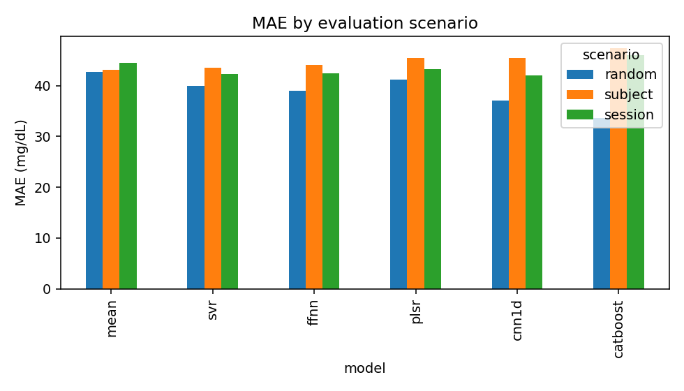
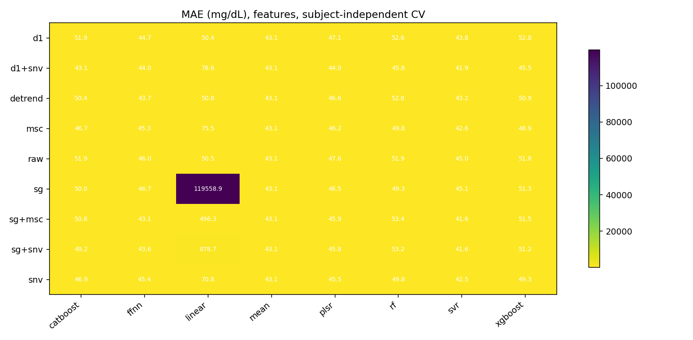
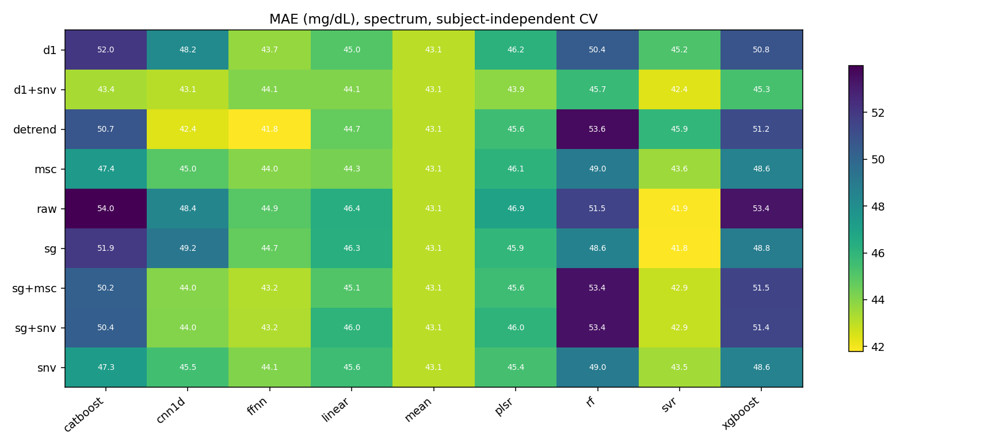
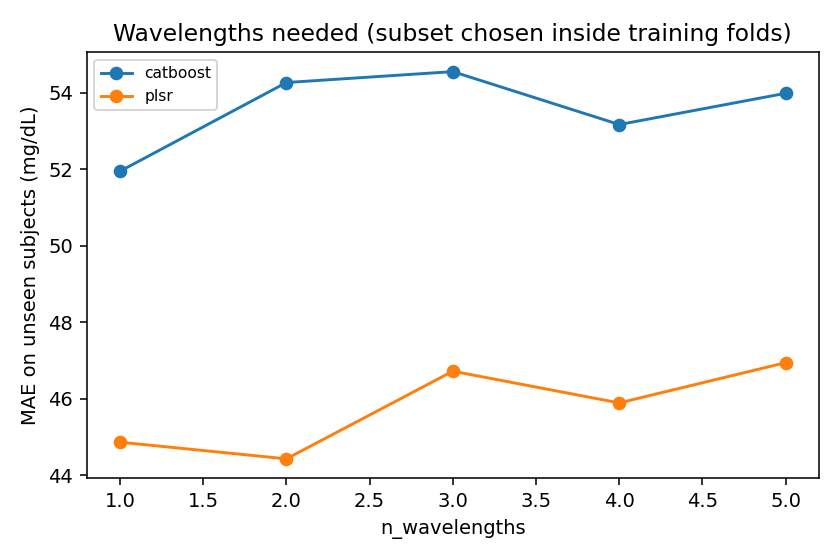
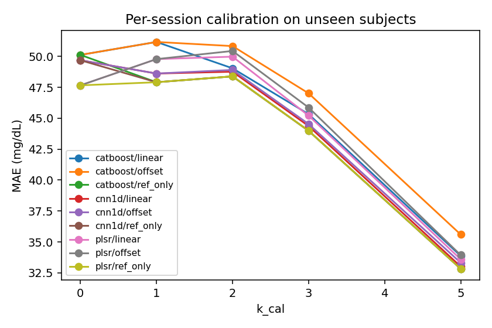
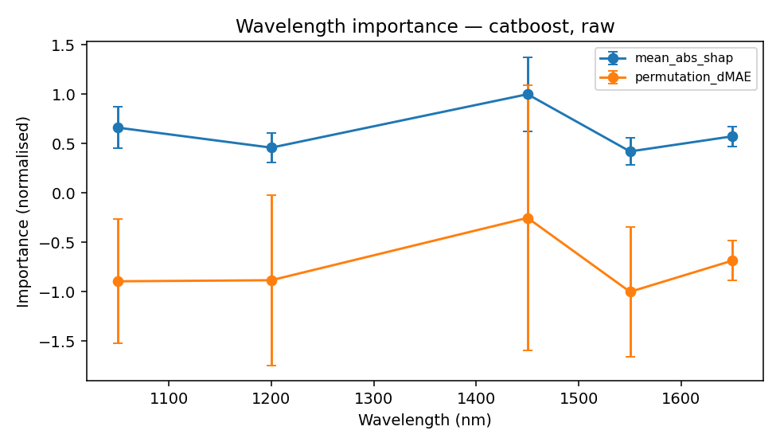
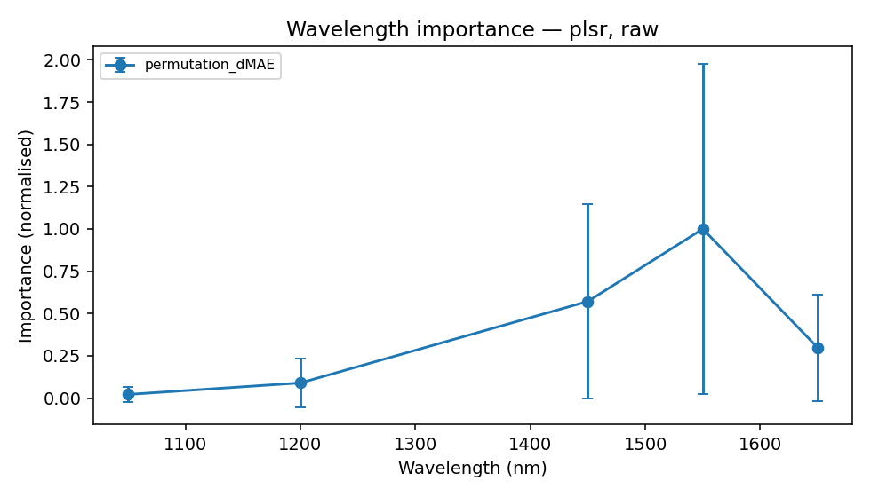

# EarSpectro experiment report

Data: `data/synthetic_ear5.csv`

> Synthetic data: these numbers validate the pipeline, not the device. See README for what the generator does and does not model.

## Evaluation scenarios (H5)

| model    | scenario   |   MAE |   RMSE |    R2 |   MARD |   clarke_A |   subject_MAE_p90 |
|:---------|:-----------|------:|-------:|------:|-------:|-----------:|------------------:|
| catboost | random     | 33.66 |  45.41 |  0.31 |  22.55 |      51.73 |             60.23 |
| catboost | session    | 45.94 |  61.42 | -0.17 |  30.06 |      41.22 |             81.50 |
| catboost | subject    | 47.31 |  61.72 | -0.28 |  32.31 |      36.31 |             87.82 |
| cnn1d    | random     | 37.04 |  50.45 |  0.15 |  24.59 |      47.45 |             68.35 |
| cnn1d    | session    | 42.04 |  56.66 |  0.00 |  27.25 |      40.90 |             85.01 |
| cnn1d    | subject    | 45.47 |  60.82 | -0.24 |  30.07 |      39.52 |             95.29 |
| ffnn     | random     | 38.98 |  53.68 |  0.04 |  25.32 |      45.95 |             75.17 |
| ffnn     | session    | 42.39 |  58.16 | -0.05 |  26.74 |      43.42 |             82.88 |
| ffnn     | subject    | 44.12 |  60.49 | -0.23 |  28.45 |      40.59 |             96.21 |
| mean     | random     | 42.74 |  54.75 | -0.00 |  30.55 |      38.06 |             81.80 |
| mean     | session    | 44.42 |  56.89 | -0.01 |  30.55 |      36.46 |             74.27 |
| mean     | subject    | 43.07 |  55.15 | -0.02 |  30.76 |      38.37 |             85.17 |
| plsr     | random     | 41.23 |  53.90 |  0.03 |  29.57 |      41.94 |             68.76 |
| plsr     | session    | 43.21 |  55.77 |  0.03 |  29.75 |      39.19 |             68.36 |
| plsr     | subject    | 45.39 |  58.71 | -0.16 |  32.08 |      38.10 |             87.55 |
| svr      | random     | 40.02 |  55.25 | -0.02 |  26.04 |      44.85 |             90.83 |
| svr      | session    | 42.34 |  56.54 |  0.01 |  27.49 |      42.61 |             75.93 |
| svr      | subject    | 43.49 |  59.08 | -0.17 |  28.49 |      40.19 |             95.98 |

## Model x preprocessing matrix — `matrix_subject` (H1, H3, H4)

Top 15 by MAE:

| representation   | preprocessing   | model   |   MAE |   RMSE |    R2 |   clarke_A |
|:-----------------|:----------------|:--------|------:|-------:|------:|-----------:|
| features         | sg+snv          | svr     | 41.60 |  57.48 | -0.11 |      42.18 |
| features         | sg+msc          | svr     | 41.62 |  57.50 | -0.11 |      42.31 |
| spectrum         | detrend         | ffnn    | 41.79 |  57.72 | -0.12 |      42.55 |
| spectrum         | sg              | svr     | 41.81 |  57.61 | -0.11 |      42.34 |
| spectrum         | raw             | svr     | 41.86 |  57.66 | -0.12 |      42.36 |
| features         | d1+snv          | svr     | 41.87 |  57.59 | -0.11 |      43.19 |
| spectrum         | d1+snv          | svr     | 42.36 |  58.23 | -0.14 |      43.44 |
| spectrum         | detrend         | cnn1d   | 42.40 |  58.40 | -0.15 |      42.60 |
| features         | snv             | svr     | 42.48 |  58.14 | -0.14 |      42.02 |
| features         | msc             | svr     | 42.63 |  58.27 | -0.14 |      41.51 |
| spectrum         | sg+snv          | svr     | 42.87 |  58.44 | -0.15 |      40.06 |
| spectrum         | sg+msc          | svr     | 42.88 |  58.45 | -0.15 |      40.11 |
| spectrum         | d1              | mean    | 43.07 |  55.15 | -0.02 |      38.37 |
| spectrum         | sg+snv          | mean    | 43.07 |  55.15 | -0.02 |      38.37 |
| spectrum         | msc             | mean    | 43.07 |  55.15 | -0.02 |      38.37 |

## How many wavelengths? (H2, nested selection)

| model    |   n_wavelengths |   MAE |    R2 | chosen_per_fold                                                                                                              |
|:---------|----------------:|------:|------:|:-----------------------------------------------------------------------------------------------------------------------------|
| plsr     |               1 | 44.86 | -0.10 | 1450;1450;1450;1450;1200                                                                                                     |
| plsr     |               2 | 44.42 | -0.09 | 1050-1450;1450-1650;1550-1650;1450-1550;1200-1650                                                                            |
| plsr     |               3 | 46.72 | -0.18 | 1050-1200-1450;1450-1550-1650;1450-1550-1650;1450-1550-1650;1050-1450-1650                                                   |
| plsr     |               4 | 45.89 | -0.14 | 1200-1450-1550-1650;1050-1450-1550-1650;1050-1200-1450-1650;1200-1450-1550-1650;1050-1200-1550-1650                          |
| plsr     |               5 | 46.94 | -0.21 | 1050-1200-1450-1550-1650;1050-1200-1450-1550-1650;1050-1200-1450-1550-1650;1050-1200-1450-1550-1650;1050-1200-1450-1550-1650 |
| catboost |               1 | 51.94 | -0.56 | 1450;1050;1050;1650;1550                                                                                                     |
| catboost |               2 | 54.26 | -0.69 | 1050-1450;1050-1650;1450-1650;1550-1650;1450-1650                                                                            |
| catboost |               3 | 54.55 | -0.73 | 1050-1200-1450;1050-1200-1550;1200-1450-1650;1450-1550-1650;1450-1550-1650                                                   |
| catboost |               4 | 53.17 | -0.62 | 1050-1200-1450-1650;1050-1200-1550-1650;1050-1450-1550-1650;1050-1450-1550-1650;1050-1450-1550-1650                          |
| catboost |               5 | 53.98 | -0.68 | 1050-1200-1450-1550-1650;1050-1200-1450-1550-1650;1050-1200-1450-1550-1650;1050-1200-1450-1550-1650;1050-1200-1450-1550-1650 |

Single-wavelength models (descriptive):

| model    |   wavelengths |   MAE |    R2 |
|:---------|--------------:|------:|------:|
| plsr     |          1050 | 44.67 | -0.10 |
| plsr     |          1200 | 43.93 | -0.07 |
| plsr     |          1450 | 43.18 | -0.04 |
| plsr     |          1550 | 42.95 | -0.03 |
| plsr     |          1650 | 42.98 | -0.03 |
| catboost |          1050 | 49.42 | -0.41 |
| catboost |          1200 | 50.06 | -0.42 |
| catboost |          1450 | 46.82 | -0.31 |
| catboost |          1550 | 48.21 | -0.38 |
| catboost |          1650 | 48.59 | -0.49 |

## Feature selection on engineered features

| model    | selector   |   k_features |   MAE |    R2 |
|:---------|:-----------|-------------:|------:|------:|
| svr      | none       |           20 | 44.99 | -0.24 |
| svr      | corr       |            5 | 42.35 | -0.15 |
| svr      | corr       |           10 | 42.33 | -0.14 |
| svr      | corr       |           20 | 42.89 | -0.16 |
| svr      | mrmr       |            5 | 42.23 | -0.13 |
| svr      | mrmr       |           10 | 42.66 | -0.15 |
| svr      | mrmr       |           20 | 42.85 | -0.15 |
| svr      | rfe        |            5 | 42.87 | -0.15 |
| svr      | rfe        |           10 | 42.87 | -0.15 |
| svr      | rfe        |           20 | 44.93 | -0.23 |
| catboost | none       |           20 | 51.90 | -0.52 |
| catboost | corr       |            5 | 50.03 | -0.45 |
| catboost | corr       |           10 | 49.38 | -0.43 |
| catboost | corr       |           20 | 49.87 | -0.39 |
| catboost | mrmr       |            5 | 52.59 | -0.52 |
| catboost | mrmr       |           10 | 52.82 | -0.56 |
| catboost | mrmr       |           20 | 52.99 | -0.60 |
| catboost | rfe        |            5 | 50.84 | -0.46 |
| catboost | rfe        |           10 | 50.64 | -0.44 |
| catboost | rfe        |           20 | 50.79 | -0.48 |

## Calibration burden (H6)

 ignores the spectra (predicts the mean calibration reference); a model is only adding information where it beats  at the same k.

| model    | method   |   k_cal |   MAE |   delta_MAE |    R2 |    n |
|:---------|:---------|--------:|------:|------------:|------:|-----:|
| plsr     | offset   |       0 | 47.66 |        0.00 | -0.17 | 2555 |
| plsr     | offset   |       1 | 49.78 |        2.12 | -0.16 | 2555 |
| plsr     | offset   |       2 | 50.44 |        2.78 | -0.17 | 2555 |
| plsr     | offset   |       3 | 45.87 |       -1.79 | -0.01 | 2555 |
| plsr     | offset   |       5 | 33.94 |      -13.72 |  0.39 | 2555 |
| plsr     | linear   |       0 | 47.66 |        0.00 | -0.17 | 2555 |
| plsr     | linear   |       1 | 49.78 |        2.12 | -0.16 | 2555 |
| plsr     | linear   |       2 | 49.98 |        2.32 | -0.15 | 2555 |
| plsr     | linear   |       3 | 45.21 |       -2.45 |  0.01 | 2555 |
| plsr     | linear   |       5 | 33.60 |      -14.06 |  0.39 | 2555 |
| plsr     | ref_only |       0 | 47.66 |        0.00 | -0.17 | 2555 |
| plsr     | ref_only |       1 | 47.91 |        0.25 | -0.11 | 2555 |
| plsr     | ref_only |       2 | 48.38 |        0.73 | -0.12 | 2555 |
| plsr     | ref_only |       3 | 43.99 |       -3.67 |  0.03 | 2555 |
| plsr     | ref_only |       5 | 32.83 |      -14.82 |  0.42 | 2555 |
| catboost | offset   |       0 | 50.12 |        0.00 | -0.28 | 2555 |
| catboost | offset   |       1 | 51.17 |        1.05 | -0.20 | 2555 |
| catboost | offset   |       2 | 50.83 |        0.71 | -0.17 | 2555 |
| catboost | offset   |       3 | 47.01 |       -3.11 | -0.04 | 2555 |
| catboost | offset   |       5 | 35.60 |      -14.52 |  0.36 | 2555 |
| catboost | linear   |       0 | 50.12 |        0.00 | -0.28 | 2555 |
| catboost | linear   |       1 | 51.17 |        1.05 | -0.20 | 2555 |
| catboost | linear   |       2 | 49.04 |       -1.08 | -0.11 | 2555 |
| catboost | linear   |       3 | 45.33 |       -4.79 |  0.01 | 2555 |
| catboost | linear   |       5 | 33.87 |      -16.25 |  0.40 | 2555 |
| catboost | ref_only |       0 | 50.12 |        0.00 | -0.28 | 2555 |
| catboost | ref_only |       1 | 47.91 |       -2.21 | -0.11 | 2555 |
| catboost | ref_only |       2 | 48.38 |       -1.74 | -0.12 | 2555 |
| catboost | ref_only |       3 | 43.99 |       -6.13 |  0.03 | 2555 |
| catboost | ref_only |       5 | 32.83 |      -17.29 |  0.42 | 2555 |
| cnn1d    | offset   |       0 | 49.69 |        0.00 | -0.32 | 2555 |
| cnn1d    | offset   |       1 | 48.61 |       -1.07 | -0.11 | 2555 |
| cnn1d    | offset   |       2 | 48.91 |       -0.78 | -0.12 | 2555 |
| cnn1d    | offset   |       3 | 44.53 |       -5.15 |  0.03 | 2555 |
| cnn1d    | offset   |       5 | 33.32 |      -16.37 |  0.41 | 2555 |
| cnn1d    | linear   |       0 | 49.69 |        0.00 | -0.32 | 2555 |
| cnn1d    | linear   |       1 | 48.61 |       -1.07 | -0.11 | 2555 |
| cnn1d    | linear   |       2 | 48.76 |       -0.93 | -0.11 | 2555 |
| cnn1d    | linear   |       3 | 44.37 |       -5.32 |  0.04 | 2555 |
| cnn1d    | linear   |       5 | 33.02 |      -16.67 |  0.42 | 2555 |
| cnn1d    | ref_only |       0 | 49.69 |        0.00 | -0.32 | 2555 |
| cnn1d    | ref_only |       1 | 47.91 |       -1.78 | -0.11 | 2555 |
| cnn1d    | ref_only |       2 | 48.38 |       -1.30 | -0.12 | 2555 |
| cnn1d    | ref_only |       3 | 43.99 |       -5.70 |  0.03 | 2555 |
| cnn1d    | ref_only |       5 | 32.83 |      -16.85 |  0.42 | 2555 |

## Wavelength importance on held-out subjects

| model    | method           |   wavelength |   mean |     std |   mean_rank |   rank_std |
|:---------|:-----------------|-------------:|-------:|--------:|------------:|-----------:|
| plsr     | permutation_dMAE |     1.55e+03 | 264    | 258     |         1.8 |      1.3   |
| plsr     | permutation_dMAE |     1.45e+03 | 151    | 152     |         2.4 |      1.52  |
| plsr     | permutation_dMAE |     1.65e+03 |  78.4  |  82.8   |         3   |      0     |
| plsr     | permutation_dMAE |     1.2e+03  |  23.7  |  38.2   |         3.4 |      1.34  |
| plsr     | permutation_dMAE |     1.05e+03 |   5.61 |  12.3   |         4.4 |      1.34  |
| catboost | mean_abs_shap    |     1.45e+03 |  14.4  |   5.42  |         1.4 |      0.894 |
| catboost | mean_abs_shap    |     1.05e+03 |   9.54 |   3.02  |         2   |      0.707 |
| catboost | mean_abs_shap    |     1.65e+03 |   8.27 |   1.46  |         3.2 |      1.3   |
| catboost | mean_abs_shap    |     1.2e+03  |   6.62 |   2.17  |         3.8 |      0.837 |
| catboost | mean_abs_shap    |     1.55e+03 |   6.06 |   1.96  |         4.6 |      0.548 |
| catboost | permutation_dMAE |     1.45e+03 |  -1.01 |   5.4   |         2.6 |      2.19  |
| catboost | permutation_dMAE |     1.05e+03 |  -3.6  |   2.52  |         3   |      1.58  |
| catboost | permutation_dMAE |     1.65e+03 |  -2.75 |   0.803 |         3   |      1     |
| catboost | permutation_dMAE |     1.2e+03  |  -3.56 |   3.48  |         3.2 |      1.48  |
| catboost | permutation_dMAE |     1.55e+03 |  -4.03 |   2.64  |         3.2 |      1.3   |

## Quality control vs injected artifacts

| artifact   |    n |   rejected |   median_Q |
|:-----------|-----:|-----------:|-----------:|
| ambient    |   26 |     100.00 |       0.00 |
| dropout    |   26 |     100.00 |       0.00 |
| motion     |   27 |      96.30 |       0.00 |
| none       | 3732 |       0.05 |       1.00 |
| saturation |   29 |     100.00 |       0.00 |
